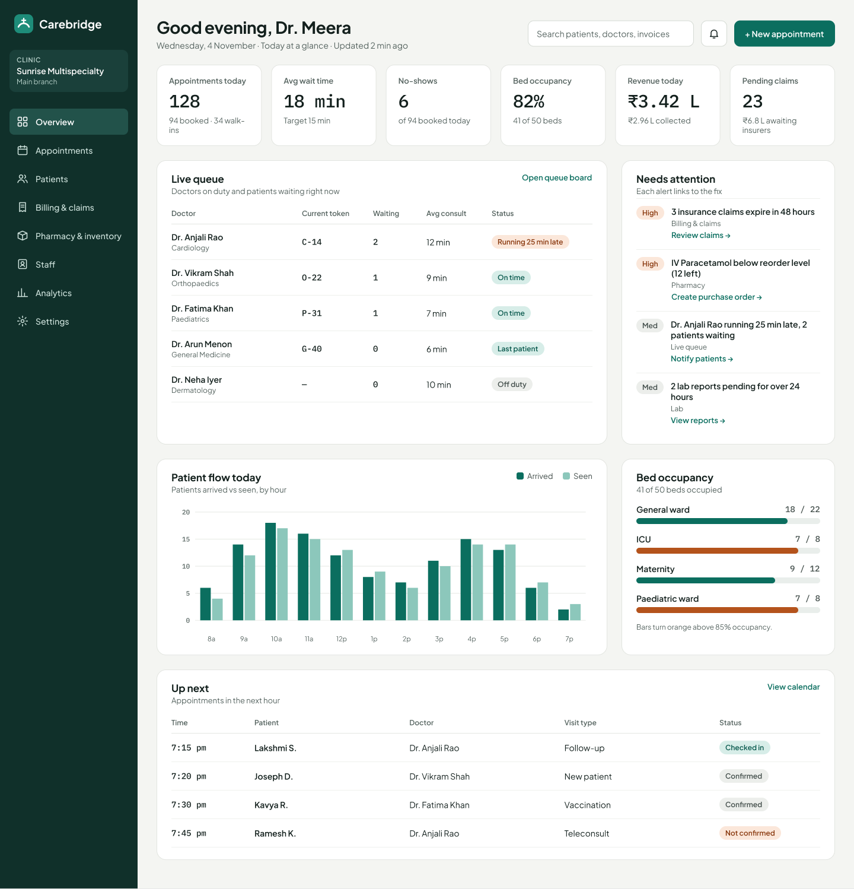
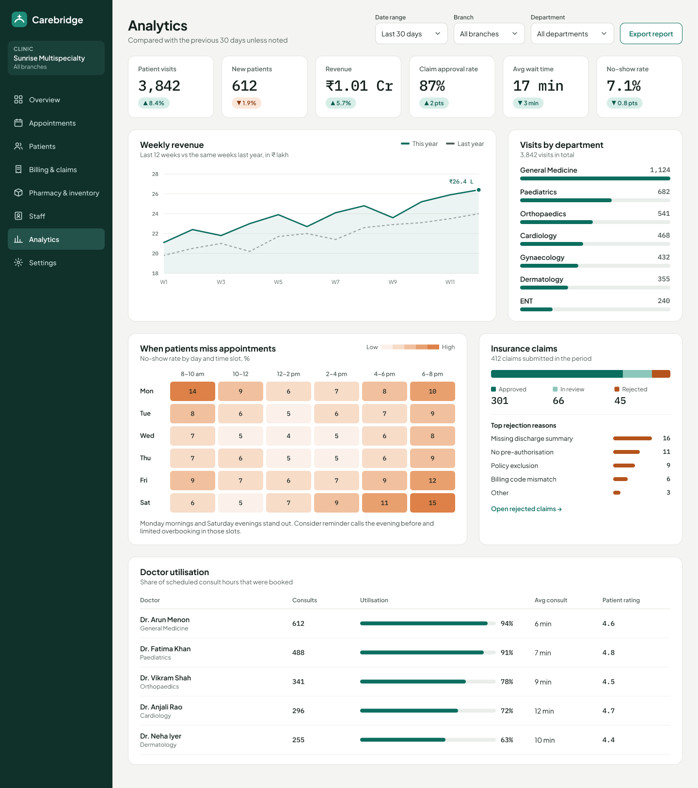
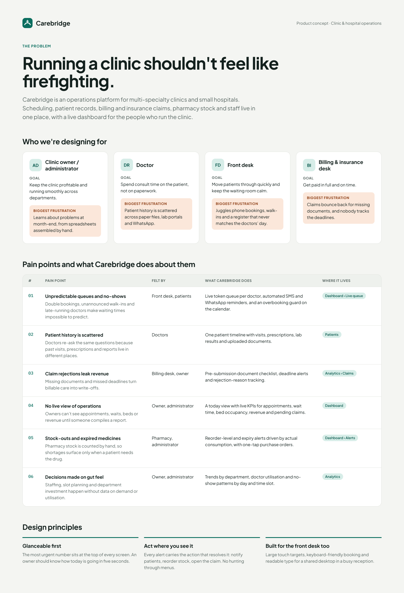

# Carebridge

A product concept for an operations platform for multi-specialty clinics and small hospitals. Scheduling, patient records, billing and insurance claims, pharmacy stock and staff live in one place, with a live dashboard and analytics for the people who run the clinic.

**Design file:** [Carebridge — Healthcare SaaS on Figma](https://www.figma.com/design/xOE2RQsNl2PRQQIbM48lKK)

## Designs

Exported from the Figma file. Full-size images are in [`designs/`](designs/).

### Operations dashboard

### Analytics

### User pain points

### Component library
Colors, typography and the reusable components behind the screens: [view the component library](designs/04-component-library.png).

## Screens as web pages

Open any page in a browser; there is no build step.

| Page | What it shows |
| --- | --- |
| [`site/index.html`](site/index.html) | User pain points: personas, pain point map, design principles |
| [`site/dashboard.html`](site/dashboard.html) | Operations dashboard: today's KPIs, live queue, alerts, patient flow, bed occupancy, upcoming appointments |
| [`site/analytics.html`](site/analytics.html) | Analytics: period KPIs, weekly revenue, visits by department, no-show heatmap, insurance claims, doctor utilisation |

To publish them, turn on GitHub Pages for this repository (Settings › Pages) and serve from the `main` branch.

## Who it's for

| Persona | Goal | Biggest frustration |
| --- | --- | --- |
| Clinic owner / administrator | Keep the clinic profitable and running smoothly | Learns about problems at month-end, from spreadsheets assembled by hand |
| Doctor | Spend consult time on the patient, not paperwork | Patient history is scattered across paper files, lab portals and WhatsApp |
| Front desk | Move patients through quickly | Juggles phone bookings, walk-ins and a register that never matches the doctors' day |
| Billing & insurance desk | Get paid in full and on time | Claims bounce back for missing documents and nobody tracks deadlines |

## Pain points and how Carebridge addresses them

1. **Unpredictable queues and no-shows** → live token queue per doctor, SMS/WhatsApp reminders, overbooking guard.
2. **Scattered patient history** → one patient timeline with visits, prescriptions, lab results and documents.
3. **Claim rejections leak revenue** → pre-submission checklist, deadline alerts, rejection-reason tracking.
4. **No live view of operations** → a today view with live KPIs.
5. **Stock-outs and expired medicines** → reorder-level and expiry alerts with one-tap purchase orders.
6. **Decisions made on gut feel** → trends by department, doctor utilisation, no-show patterns.

## Design principles

- **Glanceable first.** The most urgent number sits at the top of every screen.
- **Act where you see it.** Every alert carries the action that resolves it.
- **Built for the front desk too.** Large targets, keyboard-friendly booking, readable type.

## Visual language

- Type: Plus Jakarta Sans (UI), IBM Plex Mono (numbers)
- Colors: deep clinical teal `#0B6E5F` for primary and positive states, orange `#B4531C` for warnings, ground `#F4F5F2`, ink `#13201D`

## Note on data

The clinic, doctors, patients and every figure in these screens are invented sample data for illustration.
